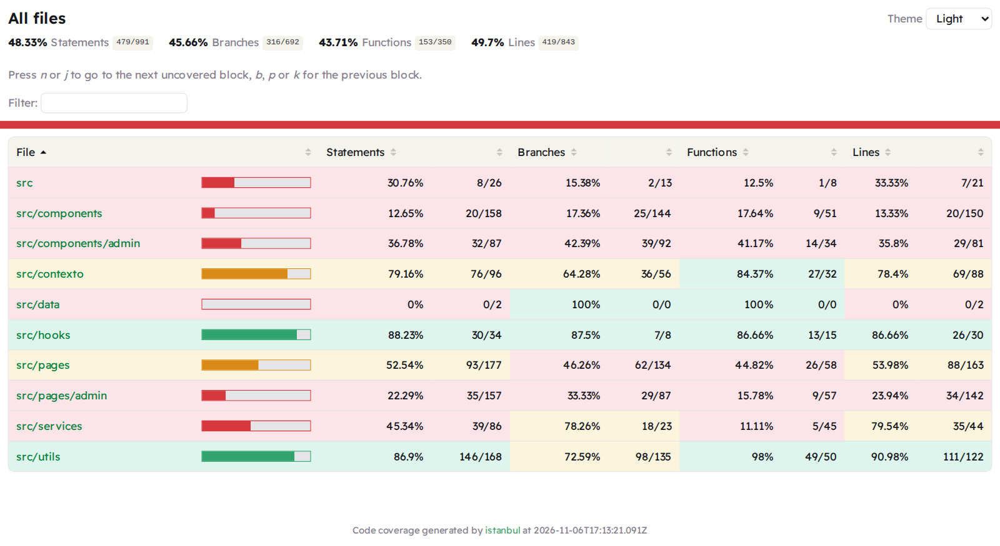
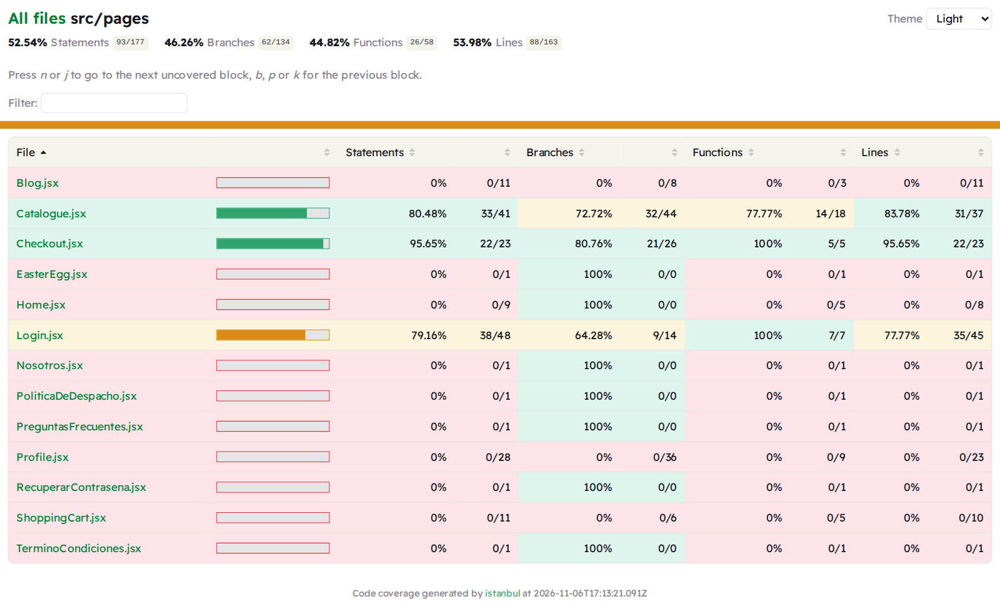
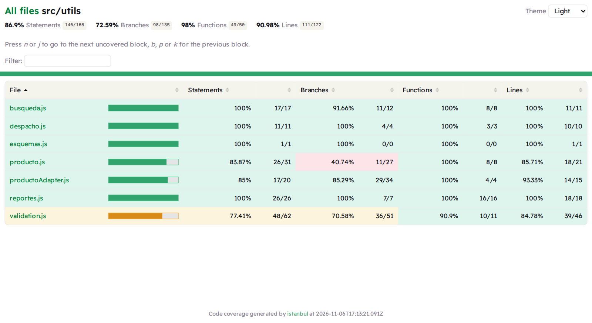
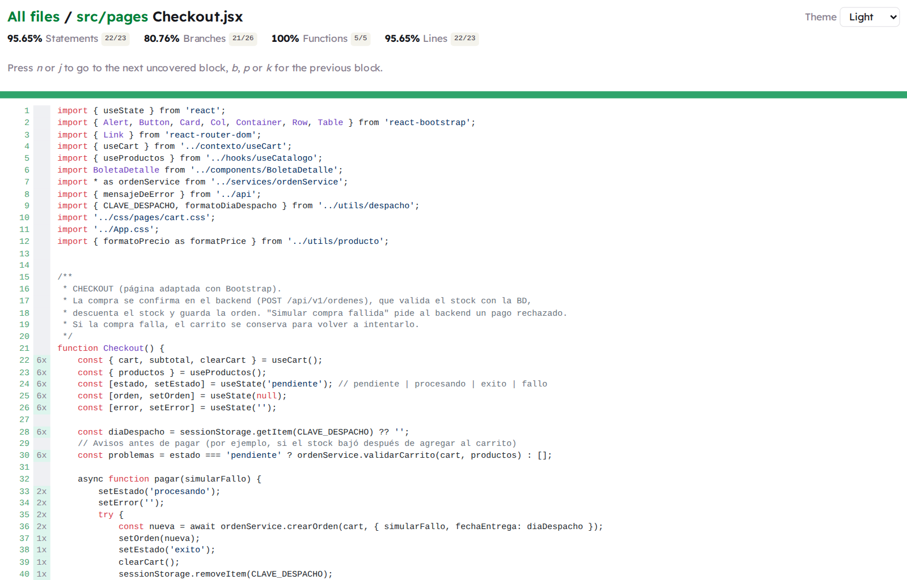

# Documento de cobertura de testing — HuertoHogar (DSY1104)

## 1. Herramienta y configuración

Las pruebas unitarias usan **Vitest** con **Testing Library**, siguiendo el tutorial *Pruebas Unitarias en
React con Vitest* del curso.

| Archivo | Qué configura |
|---|---|
| `vitest.config.js` | `globals: true`, `environment: 'jsdom'`, `setupFiles` y `coverage` (`provider: 'v8'`, reportes `text`, `json` y `html`) |
| `src/test/setupTests.js` | Se ejecuta antes de cada prueba: agrega los matchers de jest-dom y limpia el DOM, `localStorage` y los mocks |
| `src/test/test-utils.jsx` | Datos de prueba (arreglos simulados) y `renderConProveedores` (router + sesión + carrito) |
| `package.json` | Scripts `test` y `test:coverage` |

> La rúbrica menciona Jasmine y Karma. El proyecto usa Vitest, la herramienta que enseña el curso para
> React + Vite. La sintaxis es la misma: `describe`, `test`, `expect` y funciones mock.

## 2. Cómo ejecutar

| Qué | Comando |
|---|---|
| Todas las pruebas (modo vigilancia) | `npm test` |
| Todas las pruebas, una pasada | `npx vitest run` |
| **Un solo archivo** | `npx vitest run src/test/pages/Checkout.test.jsx` |
| **Una sola prueba por nombre** | `npx vitest run -t "Prueba 4"` |
| **Cobertura** | `npm run test:coverage` (equivale a `npx vitest run --coverage`) |

La cobertura se guarda en la carpeta **`coverage/`** del proyecto. Se revisa abriendo **`coverage/index.html`**.

## 3. Ubicación de las pruebas

Todas las pruebas están en **`src/test/`**, que replica la estructura de `src/`: la prueba de
`src/pages/Checkout.jsx` es `src/test/pages/Checkout.test.jsx`.

```
src/test/
├── setupTests.js           configuración común
├── test-utils.jsx          datos de prueba y renderConProveedores
├── components/             ProductoCatalogo, ProductoCarrito, AdminRoute
├── contexto/               useCart (renderHook + act)
├── hooks/                  useListado y useAgregarAlCarrito (renderHook + act)
├── pages/                  Catalogue, Checkout, Login
│   └── admin/              ProductosAdmin, CategoriasAdmin (React Hook Form + Yup)
├── services/               ordenService (validación del carrito y llamada al backend)
└── utils/                  búsqueda, reportes, validaciones, despacho y adaptador de productos
```

## 4. Las 10 pruebas solicitadas

| N° | Requisito | Archivo | Qué verifica |
|---|---|---|---|
| 1 | Renderizado de un componente | `ProductoCatalogo.test.jsx` | Muestra nombre, descripción, precio de oferta, precio anterior y el enlace al detalle |
| 2 | Visualización de productos | `Catalogue.test.jsx` | El catálogo muestra todos los productos que entrega el servicio |
| 3 | Búsqueda | `Catalogue.test.jsx` | "platano" encuentra "Plátanos" (sin tilde); "kiwi" muestra el aviso de sin coincidencias |
| 4 | Filtro de precios | `Catalogue.test.jsx` | Click en "Menor precio" y "Mayor precio" ordena bien; dos productos de $900 se desempatan por nombre |
| 5 | Filtro por categorías | `Catalogue.test.jsx` | Click en "Frutas" deja solo frutas, y se combina con el orden por precio |
| 6 | Agregar al carrito | `ProductoCatalogo.test.jsx` | Click en "Añadir al carrito" agrega el producto y actualiza el subtotal |
| 7 | Modificar cantidades | `ProductoCarrito.test.jsx` | Los botones + y − cambian la cantidad y el subtotal; no permite bajar de 1 |
| 8 | Eliminar del carrito | `ProductoCarrito.test.jsx` | Click en "Eliminar" quita el producto |
| 9 | Validación de formulario | `Login.test.jsx` | Un correo inválido muestra el error, marca el campo y no se envía |
| 10 | Compra exitosa y fallida | `Checkout.test.jsx` | **10a:** confirmación, boleta y carrito vacío. **10b:** mensaje de error y carrito conservado |

**Resultado:** `Test Files 17 passed (17)` · `Tests 43 passed (43)`. Además de las 10 pedidas, hay pruebas
del admin, de los custom hooks y de la lógica compartida.

## 5. Mocks y datos de prueba

Las pruebas **no usan el backend**:

- **Arreglos de datos de prueba** en `src/test/test-utils.jsx` (productos, categorías, ítem del carrito, órdenes).
- **`vi.mock()`** reemplaza servicios, hooks o `api.js` por respuestas controladas. Por ejemplo, en
  `Checkout.test.jsx`, `mockResolvedValue` simula la compra exitosa y `mockRejectedValue` la fallida.
- **`expect(...).not.toHaveBeenCalled()`** comprueba que un formulario inválido no se envía.

## 6. Resultado de la cobertura (`npm run test:coverage`)

| Sentencias | Ramas | Funciones | Líneas |
|---|---|---|---|
| **48,33 %** | **45,66 %** | **43,71 %** | **49,70 %** |

| Carpeta | Sentencias | Líneas |
|---|---|---|
| `src/hooks` | 88,23 % | 86,66 % |
| `src/utils` | 86,90 % | 90,98 % |
| `src/contexto` | 79,16 % | 78,40 % |
| `src/pages` | 52,54 % | 53,98 % |
| `src/services` | 45,34 % | 79,54 % |
| `src/pages/admin` | 22,29 % | 23,94 % |
| `src/components` | 12,65 % | 13,33 % |

Archivos principales: `Checkout.jsx` 95,65 % · `ProductoCarrito.jsx`, `ProductoCatalogo.jsx`, `useCart.js`,
`useListado.js` y `useAgregarAlCarrito.js` 100 % · `Catalogue.jsx` 80,48 % · `Login.jsx` 79,16 %.



En `src/pages`, el Catálogo, el Checkout y el Login están cubiertos; las páginas informativas (Home, Blog,
Nosotros...) están en 0 %, y por eso el total es más bajo:





Dentro de un archivo, la columna gris indica cuántas veces se ejecutó cada línea (por ejemplo `6x`) y las
líneas en rojo son las que ninguna prueba ejecutó:



## 7. Análisis

- **Cubierto:** el núcleo de la tienda (catálogo, búsqueda, filtros, carrito, compra y validaciones) y las
  reglas del admin, con cobertura entre 75 % y 100 %.
- **Total más bajo (48,3 %)** porque se miden todos los archivos de `src`, incluidas páginas informativas y
  componentes de presentación (Header, Footer, AdminLayout).
- **Pendiente:** Header, ShoppingCart, Profile y las páginas de Órdenes, Reportes y Usuarios del admin.
- No se fijaron mínimos (`thresholds`, opcionales en el tutorial) porque con la cobertura actual las pruebas fallarían.
- Las cifras corresponden a la ejecución real del 5 de noviembre de 2026.
