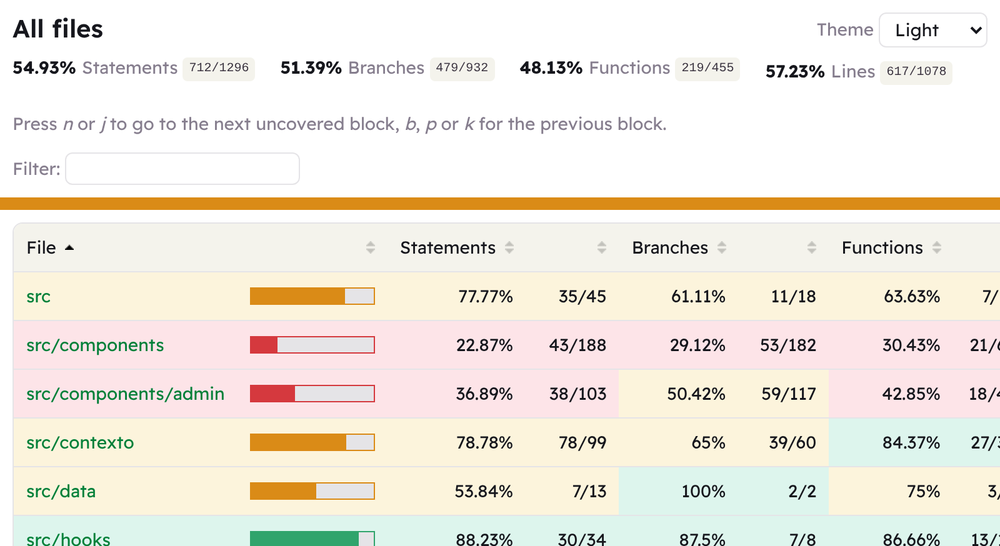
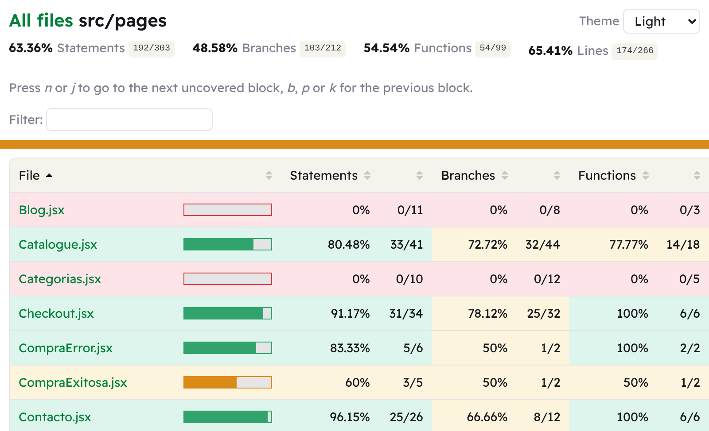
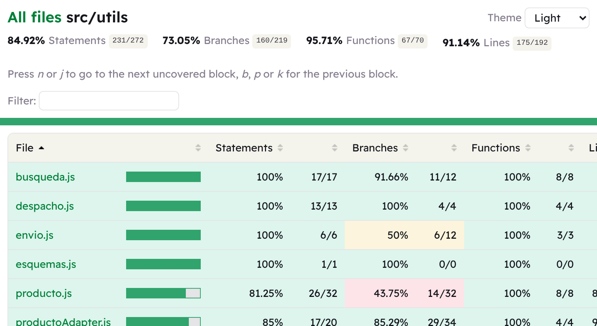
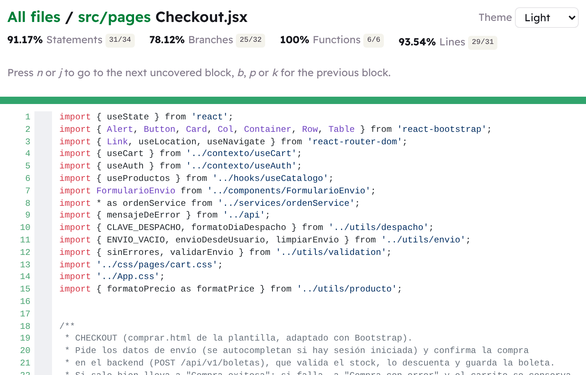

# Documento de cobertura de testing — HuertoHogar (DSY1104)

## 1. Herramienta y configuración

Las pruebas unitarias usan **Vitest** con **Testing Library**, siguiendo el tutorial *Pruebas Unitarias en
React con Vitest* del curso.

| Archivo | Qué configura |
|---|---|
| `vitest.config.js` | `globals: true`, `environment: 'jsdom'`, `setupFiles` y `coverage` (`provider: 'v8'`, reportes `text`, `json` y `html`) |
| `src/test/setupTests.js` | Se ejecuta antes de cada prueba: agrega los matchers de jest-dom y limpia el DOM, `localStorage` y los mocks |
| `src/test/test-utils.jsx` | Datos de prueba (arreglos simulados) y `renderConProveedores` (router + sesión + carrito) |
| `package.json` | Scripts `test` y `test:coverage` |

> La rúbrica menciona Jasmine y Karma. El proyecto usa Vitest, la herramienta que enseña el curso para
> React + Vite. La sintaxis es la misma: `describe`, `test`, `expect` y funciones mock.

## 2. Cómo ejecutar

| Qué | Comando |
|---|---|
| Todas las pruebas (modo vigilancia) | `npm test` |
| Todas las pruebas, una pasada | `npx vitest run` |
| **Un solo archivo** | `npx vitest run src/test/pages/Checkout.test.jsx` |
| **Una sola prueba por nombre** | `npx vitest run -t "Prueba 4"` |
| **Cobertura** | `npm run test:coverage` (equivale a `npx vitest run --coverage`) |

La cobertura se guarda en la carpeta **`coverage/`** del proyecto. Se revisa abriendo **`coverage/index.html`**.

## 3. Ubicación de las pruebas

Todas las pruebas están en **`src/test/`**, que replica la estructura de `src/`: la prueba de
`src/pages/Checkout.jsx` es `src/test/pages/Checkout.test.jsx`.

```
src/test/
├── setupTests.js           configuración común
├── test-utils.jsx          datos de prueba, sesionDe y renderConProveedores
├── api.test.js             renovación del token JWT (refreshToken) en api.js
├── components/             ProductoCatalogo, ProductoCarrito, AdminRoute (ADMIN, VENDEDOR y CLIENTE)
├── contexto/               useCart (renderHook + act)
├── hooks/                  useListado y useAgregarAlCarrito (renderHook + act)
├── pages/                  Catalogue, Checkout (+ Compra exitosa / con error), Login, Contacto
│   └── admin/              ProductosAdmin, CategoriasAdmin (React Hook Form + Yup), OrdenesAdmin
├── services/               ordenService (validación del carrito, /boletas y cambio de estado)
└── utils/                  búsqueda, reportes, validaciones (RUN, correo, contraseña), despacho y adaptador
```

## 4. Las 10 pruebas solicitadas

| N° | Requisito | Archivo | Qué verifica |
|---|---|---|---|
| 1 | Renderizado de un componente | `ProductoCatalogo.test.jsx` | Muestra nombre, descripción, precio de oferta, precio anterior y el enlace al detalle |
| 2 | Visualización de productos | `Catalogue.test.jsx` | El catálogo muestra todos los productos que entrega el servicio |
| 3 | Búsqueda | `Catalogue.test.jsx` | "platano" encuentra "Plátanos" (sin tilde); "kiwi" muestra el aviso de sin coincidencias |
| 4 | Filtro de precios | `Catalogue.test.jsx` | Click en "Menor precio" y "Mayor precio" ordena bien; dos productos de $900 se desempatan por nombre |
| 5 | Filtro por categorías | `Catalogue.test.jsx` | Click en "Frutas" deja solo frutas, y se combina con el orden por precio |
| 6 | Agregar al carrito | `ProductoCatalogo.test.jsx` | Click en "Añadir al carrito" agrega el producto y actualiza el subtotal |
| 7 | Modificar cantidades | `ProductoCarrito.test.jsx` | Los botones + y − cambian la cantidad y el subtotal; no permite bajar de 1 |
| 8 | Eliminar del carrito | `ProductoCarrito.test.jsx` | Click en "Eliminar" quita el producto |
| 9 | Validación de formulario | `Login.test.jsx` | Un RUN con dígito verificador incorrecto y un correo de dominio no permitido muestran el error, marcan el campo y no se envía |
| 10 | Compra exitosa y fallida | `Checkout.test.jsx` | **10a:** página de compra exitosa con la boleta y carrito vacío. **10b:** página de compra con error y carrito conservado |

**Resultado:** `Test Files 20 passed (20)` · `Tests 59 passed (59)`. Además de las 10 pedidas, hay pruebas
del admin, de los custom hooks y de la lógica compartida.

### Pruebas agregadas en la Evaluación 3

| Archivo | Qué verifica |
|---|---|
| `api.test.js` | Si el token de acceso venció (401), `api.js` lo renueva con el `refreshToken` y repite la petición; si la renovación falla, avisa que la sesión expiró; un 401 del login no intenta renovar |
| `AdminRoute.test.jsx` | El VENDEDOR entra al panel, pero las páginas solo para ADMIN lo llevan a productos |
| `ProductosAdmin.test.jsx` | El VENDEDOR solo ve el detalle del producto (sin crear, editar ni eliminar); la vista de críticos usa `GET /productos/criticos` |
| `OrdenesAdmin.test.jsx` | El ADMIN cambia el estado del pedido (`PATCH /boletas/{id}/estado`); el VENDEDOR solo lo ve |
| `Checkout.test.jsx` | Con sesión, los datos de envío se completan solos; sin datos de envío no se llama al backend |
| `Login.test.jsx` | La comuna depende de la región; al iniciar sesión se guardan el token de acceso y el de renovación |
| `Contacto.test.jsx` | El formulario de contacto valida dominio del correo y comentario, y envía los datos al backend |
| `validation.test.js` | RUN con módulo 11, dominios de correo permitidos y largo de la contraseña del login |
| `reportes.test.js` | Las órdenes canceladas no cuentan como venta; los críticos usan el stock crítico de cada producto |
| `ordenService.test.js` | La compra se envía a `/boletas` con los datos de envío; el cambio de estado usa `PATCH` |

## 5. Mocks y datos de prueba

Las pruebas **no usan el backend**:

- **Arreglos de datos de prueba** en `src/test/test-utils.jsx` (productos, categorías, ítem del carrito, órdenes).
- **`vi.mock()`** reemplaza servicios, hooks o `api.js` por respuestas controladas. Por ejemplo, en
  `Checkout.test.jsx`, `mockResolvedValue` simula la compra exitosa y `mockRejectedValue` la fallida.
- **`expect(...).not.toHaveBeenCalled()`** comprueba que un formulario inválido no se envía.

## 6. Resultado de la cobertura (`npm run test:coverage`)

| Sentencias | Ramas | Funciones | Líneas |
|---|---|---|---|
| **54,93 %** | **51,39 %** | **48,13 %** | **57,23 %** |

| Carpeta | Sentencias | Líneas |
|---|---|---|
| `src/utils` | 84,93 % | 91,15 % |
| `src/hooks` | 88,24 % | 86,67 % |
| `src/services` | 48,15 % | 84,91 % |
| `src` (`api.js`, `App.jsx`) | 77,78 % | 82,50 % |
| `src/contexto` | 78,79 % | 77,78 % |
| `src/pages` | 57,26 % | 59,19 % |
| `src/data` | 53,85 % | 45,45 % |
| `src/components/admin` | 36,89 % | 37,23 % |
| `src/pages/admin` | 30,11 % | 32,14 % |
| `src/components` | 22,87 % | 23,73 % |

Archivos principales: `Contacto.jsx` 96,15 % · `Checkout.jsx` 91,17 % · `api.js` 85,36 % · `CompraError.jsx` 83,33 % ·
`Login.jsx` 81,81 % · `OrdenesAdmin.jsx` 73,91 % · `ProductoCarrito.jsx`, `ProductoCatalogo.jsx`, `useCart.js`,
`useListado.js` y `useAgregarAlCarrito.js` 100 %.



En `src/pages`, el Catálogo, el Checkout y el Login están cubiertos; las páginas informativas (Home, Blog,
Nosotros...) están en 0 %, y por eso el total es más bajo:





Dentro de un archivo, la columna gris indica cuántas veces se ejecutó cada línea (por ejemplo `6x`) y las
líneas en rojo son las que ninguna prueba ejecutó:



## 7. Análisis

- **Cubierto:** el núcleo de la tienda (catálogo, búsqueda, filtros, carrito, compra y validaciones) y las
  reglas del admin, con cobertura entre 75 % y 100 %.
- **Total más bajo (54,9 %)** porque se miden todos los archivos de `src`, incluidas páginas informativas y
  componentes de presentación (Header, Footer, AdminLayout).
- **Pendiente:** Header, ShoppingCart, Profile, Ofertas, Categorías y las páginas de Reportes, Usuarios y Mensajes del admin.
- No se fijaron mínimos (`thresholds`, opcionales en el tutorial) porque con la cobertura actual las pruebas fallarían.
- Las cifras corresponden a la ejecución real del 25 de noviembre de 2026.
